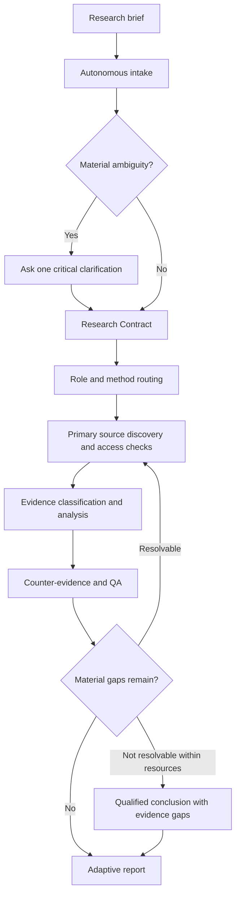

# Adaptive Deep Research Prompt

**A reusable, evidence-driven master prompt for rigorous research across academic, business, investment, legal, regulatory, technology, policy, and forensic domains.**

[](CHANGELOG.md) [](PROMPT.md) [](docs/limitations.md)

**Author:** [Rachmat Efendi](https://rachmatefendi.com)  
**Canonical prompt:** [`PROMPT.md`](PROMPT.md)  
**Initial repository version:** `v1.0`  
**Format:** Markdown; model- and platform-agnostic instructions (subject to each provider's capabilities and policies).

> **Important:** This repository contains a research *instruction template*, not an autonomous research application, a web-search service, a guarantee of factual correctness, or a validated governance enforcement system. Research quality depends on source accessibility, model behavior, tools, task design, and human review.

## Contents

- [Why this exists](#why-this-exists)
- [What's different from a typical prompt](#whats-different-from-a-typical-prompt)
- [Quick start](#quick-start)
- [How the framework works](#how-the-framework-works)
- [Configuration reference](#configuration-reference)
- [Use cases](#use-cases)
- [Evidence and verification](#evidence-and-verification)
- [Governance and authority boundaries](#governance-and-authority-boundaries)
- [Quality checks and failure modes](#quality-checks-and-failure-modes)
- [Adoption patterns](#adoption-patterns)
- [Repository layout](#repository-layout)
- [Versioning, attribution, and licensing](#versioning-attribution-and-licensing)
- [Publishing to GitHub](#publishing-to-github)

## Why this exists

A generic request such as *“Act as a world-class researcher and write a comprehensive report on X”* may produce fluent writing, but it does not explicitly specify how to:

- discover primary evidence and assess its provenance;
- separate verified facts from assumptions, estimates, and inference;
- handle paywalls, inaccessible regulations, abstracts, and partially retrieved datasets;
- detect multiple articles recycling a single underlying source;
- challenge a plausible conclusion with counter-evidence;
- stop research once further searching no longer changes material findings;
- adapt the deliverable to an academic reader, technical team, investment committee, or executive; and
- preserve the distinction between research, recommendation, decision, approval, and authorization.

This project encodes those expectations into a **single reusable research contract**. It is optimized for *defensible, decision-useful work*, not simply long answers or authoritative-sounding prose.

The master prompt is long by design: it specifies a comprehensive behavioral contract. Its **priority fallback**, conditional methods, and adaptive output requirements reduce unnecessary work when an individual assignment is smaller or resource-constrained. They do **not** eliminate model context limitations.

## What's different from a typical prompt

The following is a **design comparison against a simple generic prompting pattern**, not a benchmark against all other repositories or default models. There have been **no controlled comparative evaluations** for this release.

| Dimension | Typical short “Act as…” prompt | Adaptive Deep Research Prompt v1.0 | Intended benefit |
|---|---|---|---|
| Initial briefing | Broad expert role | Autonomous intake + scoped Research Contract | Less intake friction and clearer objective |
| Expertise | Static persona | Dynamic role and methodology routing | Less unrelated content |
| Source quality | “Use credible sources” | Tiered source heuristics + claim-level assessment | More explicit evidence standards |
| Corroboration | Count citations | Evaluate independence and circular citations | Fewer false signals of consensus |
| Missing access | Often unspecified | Access status taxonomy and qualified conclusions | Fewer claims of unperformed verification |
| Argumentation | Favor confirming narrative | Counter-evidence, alternative explanations, invalidation tests | More robust analysis |
| Research duration | “Be comprehensive” | Bounded search and convergence conditions | Focus on decision-changing evidence |
| Context pressure | No explicit degradation rule | Mandatory priority fallback and preservation order | Important safeguards are prioritized |
| Report layout | One fixed report format | Outcome-specific output contract | Better fit for audience and task |
| External materials | No explicit trust boundary | Untrusted-source prompt injection instructions | Reduced instruction-confusion risk (not guaranteed protection) |
| Decision governance | Implicit authority | Research ≠ recommendation ≠ decision ≠ approval ≠ execution | Clearer authority boundaries |

### The seven differentiators

**1. Autonomous by default.** Provide a topic or a brief. The prompt infers reasonable defaults and only requests clarification when material ambiguity would change the scope, method, or consequences. This is *not* a promise to never ask questions.

**2. Method over persona.** The template selects fit-for-purpose analytical functions rather than simulating a room full of experts. A legal research request should focus on the current primary legal instruments and interpretive limits; a systems assessment should focus on architecture trade-offs and verification criteria.

**3. Evidence is classified, not just cited.** `VERIFIED FACT`, `SOURCE-DERIVED CLAIM`, `ASSUMPTION`, `INFERENCE`, `ESTIMATE / PROJECTION`, `RECOMMENDATION`, and `EVIDENCE GAP` have distinct roles. The aim is to prevent assumptions or forecasts from masquerading as observed outcomes.

**4. Verification is access-aware.** Research may be performed with incomplete browsing, indexed abstracts, or restricted primary documents. The prompt requires a clear distinction between examined source content and material that was merely identified or reported secondhand.

**5. Contradictions are investigated.** It explicitly calls for original-source tracing, circular-citation detection, cross-source reconciliation, and alternative hypotheses. A source count is not the same as independent evidence.

**6. Quality controls survive resource pressure.** If the model cannot fulfill every instruction, accuracy, provenance, counter-evidence, and disclosure outrank presentational polish. The prompt requires a bounded result rather than fictitious completion.

**7. Governance is conditional.** Everyday research stays relatively light. Material decisions receive additional risk/authority scrutiny. References to AFGS/MDGR do not automatically grant those frameworks execution authority.

## Quick start

### Option A — Minimal input (recommended)

1. Open [`PROMPT.md`](PROMPT.md) and copy the complete prompt into your AI research session or reusable instruction profile.
2. Replace `RESEARCH TOPIC` with your own question or paste your brief after the master prompt.
3. Enable browsing/deep research and any approved document sources **if your environment supports them**.
4. Run the research and inspect the resulting source citations, access limitations, counter-evidence, and evidence gaps.

**Example user brief:**

```text
RESEARCH TOPIC:
Assess the opportunities and operational risks of AI-assisted
accounting workflows for Indonesian SMEs. Focus on data security,
customer adoption, implementation cost, and applicable regulations.
Provide a formal Bahasa Indonesia research report for founders.
```

Everything else can remain `AUTO`.

### Option B — Controlled configuration

```text
RESEARCH TOPIC:
Evaluate the financing risks of infrastructure projects backed
by long-term concession agreements in Indonesia.

Research Objective: Identify bankability constraints and controls.
Expected Outcome: INVESTMENT
Target Audience: INVESTORS
Research Depth: COMPREHENSIVE
Geographic Scope / Jurisdiction: INDONESIA
Research Time Horizon: CURRENT
Output Language: BAHASA INDONESIA
Writing Style: EXECUTIVE
Evidence Standard: HIGH-ASSURANCE RESEARCH
Governance Profile: MATERIAL_DECISION_RESEARCH
Deliverable Format: DECISION MEMO
Excluded Scope: Transaction approval or binding legal advice
```

### Option C — Attach source documents

Include files such as policies, financial statements, project agreements, datasets, or technical documentation. Specify which records are **authoritative inputs** and which are **unverified submissions**. The prompt still requires independent verification where material and accessible; attaching a document does not guarantee authenticity.

## How the framework works



The process is **conceptual**. This repository does not provide a workflow engine, evidence database, or enforcement runtime.

### Research Contract

The model establishes an internal working contract covering the primary question, objective, exclusions, audience, methodology, evidence requirement, governance profile, and completion criteria. Material assumptions should be inspectable through the report's **Research Configuration** section.

### Adaptive output

A report does not need every possible heading. Depending on the outcome, it may emphasize a scholarly literature review, regulatory analysis, investment memo, technical decision record, or operational SOP design. The core obligation remains evidence traceability and qualified conclusions.

## Configuration reference

| Parameter | Default when omitted | When to override |
|---|---|---|
| `Research Objective` | Inferred from brief | Several plausible end goals |
| `Expected Outcome` | Relevant research report | An academic article, technical spec, decision memo, SOP |
| `Target Audience` | Inferred | Publication-specific expectations |
| `Research Depth` | `COMPREHENSIVE` | Quick scoped overview or deeper diligence |
| `Geographic Scope / Jurisdiction` | Inferred | Rules or practices differ by jurisdiction |
| `Research Time Horizon` | Relevant period | Historical comparison, strict as-of date, forecast |
| `Output Language` | User's language | Bilingual or English deliverable |
| `Writing Style` | Formal analytical | Academic, technical, executive |
| `Evidence Standard` | Primary/authoritative where available | High-stakes decisions, research protocol |
| `Governance Profile` | `STANDARD_RESEARCH` | Material decisions; explicit AFGS/MDGR study |
| `Deliverable Format` | Structured report | White paper, paper, memo, SOP, other |
| `Source Restrictions` | None | Restricted databases, approved repositories, jurisdiction |
| `Excluded Scope` | None | Prevent overreach into approval, execution, or legal opinion |

Use `MATERIAL_DECISION_RESEARCH` when research can materially affect investments, financing, compliance, major technical design, or other consequential commitments. Use `AFGS_MDGR_REFERENCE` only when AFGS/MDGR is explicitly requested or is itself being researched—not for generic governance discussions.

## Use cases

Each file contains a **ready-to-paste research brief** to run *after* `PROMPT.md`, plus intended outputs and specific verification cautions. These are examples of requests, **not completed studies and not evidence for their subject matter**.

| File | Domain | Illustrative outcome |
|---|---|---|
| [`01-academic-literature-review.md`](examples/01-academic-literature-review.md) | Academic | Literature synthesis with methodological limitations |
| [`02-indonesia-regulatory-assessment.md`](examples/02-indonesia-regulatory-assessment.md) | Legal / Regulatory | Indonesia regulatory landscape and status mapping |
| [`03-structured-financing-investment.md`](examples/03-structured-financing-investment.md) | Finance / Investment | Downside-oriented investment decision support |
| [`04-saas-architecture-assessment.md`](examples/04-saas-architecture-assessment.md) | Technology | Architecture alternatives and testing prerequisites |
| [`05-forensic-audit-sop.md`](examples/05-forensic-audit-sop.md) | Audit / Operations | Controls and forensic SOP research |
| [`06-indonesia-saas-market.md`](examples/06-indonesia-saas-market.md) | Business / Strategy | Market structure, GTM and unit-economics research |
| [`07-afgs-mdgr-governance.md`](examples/07-afgs-mdgr-governance.md) | Governance | Reference-only framework analysis |
| [`08-public-policy-comparison.md`](examples/08-public-policy-comparison.md) | Public policy | Comparative policy analysis |

### Best practices for prompts

- State your *decision or research question*, not only the general topic.
- Supply known constraints, geography, time horizon, and source documents when available.
- Distinguish draft proposals from currently effective law and actual system deployments.
- Ask for citations near material claims and explicitly request any missing-source register.
- Use professional review for consequential decisions; generated conclusions do not imply approval.
- Re-run searches where evidence changes rapidly; a completed report is an as-of snapshot.

## Evidence and verification

The project separates source provenance and **claim strength**. An official primary source may be authoritative on its own publication or binding wording without being conclusive on every empirical assertion. A systematic review can be more informative than a single original study for some scientific questions.

**Material claim target:** one directly examined authoritative source, or two genuinely independent high-quality analytical sources when a primary source is inaccessible or inappropriate. This is a *heuristic*, not a universal threshold or a reason to invent corroboration.

**Access states:** `ACCESSIBLE / VERIFIED`, `PARTIALLY ACCESSED`, `IDENTIFIED / NOT ACCESSED`, `RESTRICTED`, `NOT FOUND`, and `UNVERIFIED`.

**Citation rule:** sources must be traceable; fabricated links, clauses, page numbers, and DOIs are prohibited. Repeated references to the same underlying study do not count as independent corroboration. See [`docs/evidence-policy.md`](docs/evidence-policy.md).

## Governance and authority boundaries

The template recognizes three research modes: `STANDARD_RESEARCH`, `MATERIAL_DECISION_RESEARCH`, and `AFGS_MDGR_REFERENCE`.

The third is an **optional, reference-only overlay**. It neither alters any external AFGS normative specification nor issues MDGR verdicts. Abbreviations such as IAR, EPS, PCR, and GEG are used as scoped references for research on that architecture; the repository is **not** an AFGS implementation.

**Research ≠ Recommendation ≠ Decision ≠ Approval ≠ Execution Authorization.**

Prompt instructions are not permission systems, runtime guardrails, external validators, audit evidence stores, or enforcement gateways. See [`docs/governance-boundaries.md`](docs/governance-boundaries.md).

## Quality checks and failure modes

The template includes six QA families: objective alignment, evidence integrity, analytical integrity, critical challenge, practical/governance validity, and completeness. It aims to avoid:

- **Source laundering:** quoting a reporter's summary as if the original were read.
- **Circular citation:** counting correlated references as multiple independent sources.
- **False precision:** fabricated thresholds, percentages, or estimates.
- **Persona inflation:** substituting “world-class expert” rhetoric for verification.
- **Output padding:** forcing irrelevant sections because a format suggests them.
- **Unbounded research:** continuing searches without decision-relevant value.
- **Instruction injection:** treating instructions embedded in retrieved data as controlling directions.
- **Authority confusion:** promoting analysis into authorization.

For an acceptance-test matrix (including negative cases), see [`docs/evaluation-plan.md`](docs/evaluation-plan.md). These tests are specified, **not yet executed**; no accuracy or comparative-performance claims are made.

## Adoption patterns

**Chat or web research:** Paste `PROMPT.md`, add a brief, and independently inspect citations and evidence gaps.

**Custom AI instructions:** Use the template or a condensed derivative compatible with the system's instruction limit. Preserve evidence, access, challenge, and non-fabrication rules when shortening.

**Agent application:** Start with a single agent plus narrowly scoped retrieval/calculation tools and an inspectable Research Contract. Add evaluators, tool permission checks, trace logging, and human approval for external side effects as appropriate. This repository does **not** ship agent code or a deployed service.

**Human-in-the-loop decision support:** Treat the output as research input to a separate decision/approval process, not as a decision itself.

## Repository layout

```text
adaptive-deep-research-prompt/
├── README.md
├── PROMPT.md                 # Canonical master prompt
├── VERSION
├── CHANGELOG.md
├── LICENSE                   # MIT License
├── docs/
│   ├── evidence-policy.md
│   ├── governance-boundaries.md
│   ├── limitations.md
│   ├── evaluation-plan.md
│   └── publishing.md
└── examples/
    ├── 01-academic-literature-review.md
    ├── 02-indonesia-regulatory-assessment.md
    ├── 03-structured-financing-investment.md
    ├── 04-saas-architecture-assessment.md
    ├── 05-forensic-audit-sop.md
    ├── 06-indonesia-saas-market.md
    ├── 07-afgs-mdgr-governance.md
    └── 08-public-policy-comparison.md
```

## Versioning, attribution, and licensing

`v1.0` is the first **repository release**. The source prompt was previously discussed as v2.0.1; the repository starts a new release sequence while retaining its substantive baseline. See [`CHANGELOG.md`](CHANGELOG.md).

**Author:** Rachmat Efendi — [rachmatefendi.com](https://rachmatefendi.com).

**Copyright:** © 2026 Rachmat Efendi.

**License:** [MIT License](LICENSE), selected by the author on 2026-10-29.

**Status:** Documentation package prepared; empirical reliability, protection against prompt injection, and compliance with every model instruction have not been independently validated.

## Publishing to GitHub

See [`docs/publishing.md`](docs/publishing.md) for suggested repository metadata, staging visibility, and commands to create the first commit and `v1.0` tag. **This documentation package does not itself establish that GitHub hosting has been completed.**
